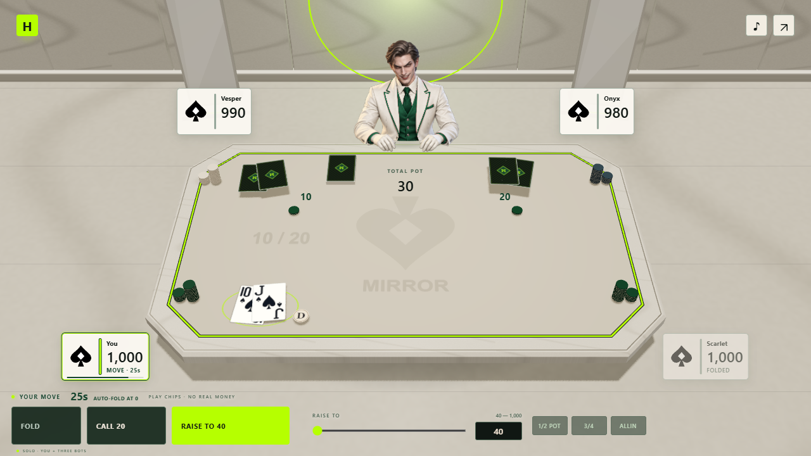

# Mirror Poker

A standalone 3D Texas Hold'em game against three bots. Before each hand, the Dealer chooses one of two worlds:

- **HOLDEM:** aces are high and twos are low.
- **MIRROR:** twos are high and aces are low.

Hand categories keep their usual order. The world stays fixed until the pot is paid.

**[Play online on Remix](https://remix.gg/g/mirror-poker)** · [Run the standalone edition locally](#play-locally)

The online link opens the original hosted Remix edition. This repository contains the standalone game against bots.



This edition runs in your browser without Remix, an account, API keys, or a backend. It uses play chips only. Multiplayer queues, platform profiles, and global ratings are not included.

## Play locally

Install **Node.js 22.12+** (Node.js 24 LTS recommended), then download or clone this repository:

```sh
git clone https://github.com/azkian1/MirrorPoker.git
cd MirrorPoker
npm ci
npm start
```

Open the address printed in the terminal, normally `http://127.0.0.1:5173/`. On Windows, double-click **start-preview.cmd** after installing Node.js; it installs the project dependencies on the first launch and opens the browser.

Choose **Play vs Bots**, read the two-world rules, then press **Play**. Use **H** for hand rankings, the blind schedule, and table standings. The audio button mutes the game; the menu switch previews either world. Landscape works best on phones.

Keep the terminal open while playing. Opening the source `index.html` directly does not compile TypeScript; it displays launch instructions instead.

## Build and share

```sh
npm run build
npm run preview
```

The `dist/` folder is a static website. Serve that folder with any static web server or upload its contents to static hosting. Relative asset paths also work under a subdirectory. The first dependency installation needs internet; gameplay and the built site load their code, art, and audio locally, with no CDN or service requests.

A refreshed or closed page ends the current match. There is no saved progress or shared leaderboard.

## Rules and controls

- You and three bots start with **1,000 chips** each. There are no rebuys or antes; first place wins.
- Blinds start at **10/20** and increase every three minutes, taking effect on the next hand. Use H to see current and next blinds.
- Fold, Check/Call, and Bet/Raise appear only when legal. The slider and number field specify your **total bet on the current street**. Presets offer half pot, three-quarter pot, and all-in.
- A decision lasts **30 seconds**. Expiry always folds. Two consecutive timeouts reduce later decisions to **10 seconds**; an accepted manual action restores the normal allowance. A warning sounds in the final five seconds when audio is enabled.
- Cards are never relabelled. In MIRROR, comparisons, kickers, and straights follow the reversed rank order. The strongest MIRROR straight flush is **A2345**; in HOLDEM it is **TJQKA**.
- Hands advance automatically. The Dealer's snap synchronizes world changes, costume, lighting, and audio. Last Hand preserves the previous payout.

## Development and checks

```sh
npm run dev
npm run typecheck
npm test
npm run build
```

`npm test` runs the engine, bots, session timing, presentation, geometry, and audio unit regressions. For real Chromium/WebGL, full-game, layout, all-52-card, and audio-decoding checks:

```sh
npx playwright install --no-shell chromium
npm run test:browser
```

On Linux CI, use `npx playwright install --with-deps --no-shell chromium`. Browser checks require the production build (`npm run build`) first. Generated reports and screenshots stay in ignored directories.

## Source and licensing

The standalone edition was checked against the [published Mirror Poker](https://remix.gg/g/mirror-poker) on **12 November 2026**, live version `1ca1eab6-c951-4d0b-899b-b59e90d616cf`. Its gameplay JavaScript and CSS matched the local source after normalizing build names, redundant parentheses, and whitespace. No gameplay patch was missing; this edition replaces the platform integration and launch tooling.

Original project code is available under the [MIT License](LICENSE). See [THIRD_PARTY.md](THIRD_PARTY.md) for the adapted poker engine, CC0 cards and audio, and generated art provenance. [Project.md](Project.md) maps the implementation.
